  

  
  
  
  

##  About

I build systems that replace spreadsheets, paper and email chains with **one source of truth**: web platforms in **Next.js, TypeScript and Postgres**, business apps on **Microsoft Power Platform**, and AI assistants grounded in real data instead of guesswork.

<table>
  <tr>
    <td> <b>Now</b></td>
    <td>Power Apps Developer at <b>Pathways Technologies</b></td>
  </tr>
  <tr>
    <td> <b>Based in</b></td>
    <td>Kenya, building for East Africa and beyond</td>
  </tr>
  <tr>
    <td> <b>Learning</b></td>
    <td>Flutter and React Native</td>
  </tr>
  <tr>
    <td> <b>Open to</b></td>
    <td>govtech, fintech, agritech and anything that solves real problems for real people</td>
  </tr>
</table>

> I've written more RLS policies than I've had hot meals this week.

##  Selected work

###  Stock Take &amp; Reconciliation Suite

Power Platform solution that replaces paper count sheets and month-end Excel reconciliation in a coffee exporter's warehouses.

<table>
  <tr>
    <td align="center"><b>2</b> code apps</td>
    <td align="center"><b>20</b> Dataverse tables</td>
    <td align="center"><b>7</b> security roles</td>
    <td align="center"><b>12</b> Power Automate flows</td>
    <td align="center"><b>12</b> live reports</td>
  </tr>
</table>

<b>How it works</b>

 

- **Counter phone app**: outturn-first, *blind* counting (counters never see system quantities, so counts stay honest), one-pocket-per-lot rule, tag photos, offline queueing, stack checklist and floor map
- **Management hub**: ERP stock import with validation checks, count-sheet approvals, a variance engine that suggests the likely cause of every difference, exceptions with SLA escalation, mapping approvals, a 4-gate sign-off, and reports exported to Excel
- **Dataverse back end**: ERP data locked against edits, full auditing, photos stored as attachments
- **Automation**: Teams alerts to supervisors and counters, Finance approvals, daily exception escalation, a sign-off chain that emails the month-end pack, and a count report the morning after every count
- **Infrastructure as code**: schema, roles, seed data and flows rebuilt from Node scripts over the Dataverse Web API

`Power Apps code apps` · `React` · `TypeScript` · `Vite` · `Dataverse` · `Power Automate` · `Teams` · `Approvals`

###  Kenya Trade Intelligence Platform (KTIP)

Trade decision-support platform for Kenya's State Department for Trade, pulling fragmented trade data into one view where every figure traces back to its source agency.

<table>
  <tr>
    <td align="center"><b>2.7M+</b> transaction rows</td>
    <td align="center"><b>8</b> analysis tools</td>
    <td align="center"><b>7</b> scoring dimensions, in SQL</td>
    <td align="center"><b>1</b> read-only AI analyst</td>
  </tr>
</table>

<b>How it works</b>

 

- **Tools**: product and market explorer, landed-cost estimator, market opportunity engine, barrier monitor, exporter capacity map, step-by-step procedures, live trade news, embedded BI dashboards
- **AI Trade Analyst**: Claude with a single hardened, read-only SQL tool, so every answer comes from a query it actually ran (streaming, prompt caching, rate limiting)
- **Data**: Neon Postgres, BI views for Apache Superset, World Bank WITS tariff sync and NewsAPI ingestion on GitHub Actions
- **Accounts**: self-hosted NextAuth (email/password, Google, LinkedIn, GitHub, Facebook), watchlists, in-app and email notifications

`Next.js 16` · `React 19` · `TypeScript` · `PostgreSQL (Neon)` · `Drizzle ORM` · `Tailwind` · `Claude API` · `NextAuth` · `GitHub Actions`

<!-- Replace YOUR-KTIP-REPO with the real repo name, or delete this card -->

###  NSIF South Sudan

Government-grade social insurance platform for the National Social Insurance Fund of the Republic of South Sudan.

<b>How it works</b>

 

- **Public website** with Sanity CMS, English and Arabic, and full accessibility
- **Member self-registration** with a multi-step form, document upload and email verification
- **Employer portal** with Pesapal payments for monthly contributions
- **Staff CRM** with role-based access, document verification through Supabase Storage signed URLs, automated NSIF number generation (Luhn check digit) and full audit logging

`Next.js 16` · `TypeScript` · `Supabase` · `PostgreSQL` · `Tailwind` · `Sanity` · `Nodemailer` · `Pesapal`

###  Also building

<table>
  <tr>
    <td width="50%" valign="top">
       <b>Northlink Consulting</b> 
      Website revamp for a consulting firm working across East and Central Africa: a design system built from scratch, a Next.js component library, an editorial page set and a 3-slide hero.  
      <code>Next.js</code> <code>TypeScript</code> <code>CSS Modules</code>
    </td>
    <td width="50%" valign="top">
       <b>KALRO-WEB</b> 
      Official website for the Kenya Agricultural and Livestock Research Organization.  
      
    </td>
  </tr>
</table>

##  Stack

<table>
<tr><td width="200"> <b>Languages</b></td><td>    </td></tr>
<tr><td width="200"> <b>Frontend</b></td><td>    </td></tr>
<tr><td width="200"> <b>Power Platform</b></td><td>   </td></tr>
<tr><td width="200"> <b>Backend & data</b></td><td>      </td></tr>
<tr><td width="200"> <b>CMS & integrations</b></td><td>   </td></tr>
<tr><td width="200"> <b>AI & data science</b></td><td>    </td></tr>
<tr><td width="200"> <b>Tooling</b></td><td>      </td></tr>
</table>

##  On GitHub

  
  

  

##  Get in touch

Working on something in govtech, fintech or agritech across Africa? I'd like to hear about it.

  
  
  
  

  

